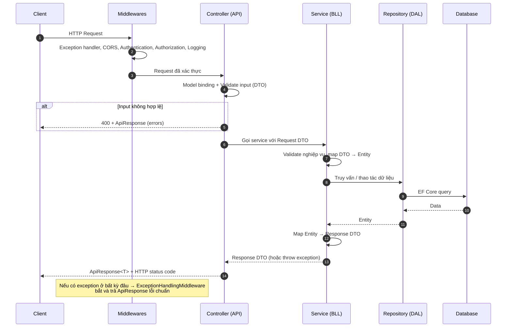

# 01 — Coding Conventions & Workflow

> Tài liệu quy định chung cho team Backend **renTrek** (ASP.NET Core Web API).
> Mọi thành viên **bắt buộc** tuân theo. Khi cần thay đổi rule, tạo PR sửa file này và thông báo cho cả team.

## Mục lục

1. [Naming Convention](#1-naming-convention)
2. [Flow xử lý Request → Response](#2-flow-xử-lý-request--response)
3. [Cấu trúc Request](#3-cấu-trúc-request)
4. [Cấu trúc Response](#4-cấu-trúc-response)
5. [Git: Branch, Commit, Push](#5-git-branch-commit-push)
6. [Checklist trước khi tạo PR](#6-checklist-trước-khi-tạo-pr)

---

## 1. Naming Convention

### 1.1. C# code

| Thành phần | Quy tắc | Ví dụ |
|---|---|---|
| Namespace | `PascalCase`, theo cấu trúc thư mục | `RenTrek.BLL.Services.Implementations` |
| Class / Record / Struct | `PascalCase`, danh từ | `ProductService`, `BookingRepository` |
| Interface | Tiền tố `I` + `PascalCase` | `IProductService`, `IGenericRepository<T>` |
| Method | `PascalCase`, động từ | `GetByIdAsync`, `CreateBooking` |
| Method async | Hậu tố `Async` | `GetAllAsync`, `SaveChangesAsync` |
| Property (public) | `PascalCase` | `FullName`, `CreatedAt` |
| Field private | `_camelCase` | `_productRepository`, `_unitOfWork` |
| Biến local, parameter | `camelCase` | `productId`, `pageSize` |
| Constant | `PascalCase` | `DefaultPageSize`, `MaxUploadSizeMb` |
| Enum | `PascalCase`, **số ít** | `BookingStatus.Pending`, `UserRole.Admin` |
| Boolean | Tiền tố `Is` / `Has` / `Can` | `IsActive`, `HasPaid`, `CanCancel` |
| Generic type | Tiền tố `T` | `TEntity`, `TResponse` |

**Quy tắc chung:**

- Mỗi file chỉ chứa **1 class / interface / enum** chính; tên file trùng tên class.
- Không viết tắt khó hiểu (`usr`, `prd`, `qty`...). Chấp nhận các từ viết tắt phổ biến: `Id`, `Dto`, `Url`, `Api`.
- Từ viết tắt ≥ 3 ký tự viết như từ thường: `HttpClient`, `JsonOptions` (không phải `HTTPClient`).

### 1.2. Theo từng layer

| Loại | Pattern | Ví dụ |
|---|---|---|
| Controller | `{Resource số nhiều}Controller` | `ProductsController`, `BookingsController` |
| Service interface / impl | `I{Entity}Service` / `{Entity}Service` | `IProductService` / `ProductService` |
| Repository interface / impl | `I{Entity}Repository` / `{Entity}Repository` | `IProductRepository` / `ProductRepository` |
| Entity | `{Entity}` (số ít) | `Product`, `Booking`, `User` |
| Request DTO | `{Action}{Entity}Request` | `CreateProductRequest`, `UpdateProductRequest` |
| Query DTO (filter/paging) | `{Entity}QueryRequest` | `ProductQueryRequest` |
| Response DTO | `{Entity}Response` / `{Entity}DetailResponse` | `ProductResponse`, `ProductDetailResponse` |
| Validator (FluentValidation) | `{RequestName}Validator` | `CreateProductRequestValidator` |
| Custom Exception | `{Mô tả}Exception` | `NotFoundException`, `BadRequestException` |
| Middleware | `{Chức năng}Middleware` | `ExceptionHandlingMiddleware` |
| EF Configuration | `{Entity}Configuration` | `ProductConfiguration` |
| Mapping profile | `{Entity}Profile` / `{Entity}Mapper` | `ProductProfile` |

### 1.3. API Endpoint (URL)

- Prefix: `/api/v{version}/` → ví dụ `/api/v1/products`.
- Resource là **danh từ số nhiều**, **kebab-case**, chữ thường: `/api/v1/rental-orders`.
- **Không** dùng động từ trong URL (HTTP method đã thể hiện hành động).
  - ✅ `POST /api/v1/products` — ❌ `POST /api/v1/products/create`
- Resource lồng nhau tối đa **2 cấp**: `/api/v1/users/{userId}/bookings`.
- Hành động đặc biệt không thuộc CRUD dùng sub-resource động từ (ngoại lệ có kiểm soát):
  `POST /api/v1/bookings/{id}/cancel`, `POST /api/v1/auth/login`.
- Path param: `camelCase` trong route template → `{productId}` hoặc `{id}`.
- Query param: `camelCase` → `?pageNumber=1&pageSize=10&sortBy=createdAt&sortOrder=desc`.

| Method | Mục đích | Ví dụ |
|---|---|---|
| `GET` | Lấy danh sách / chi tiết | `GET /api/v1/products`, `GET /api/v1/products/{id}` |
| `POST` | Tạo mới | `POST /api/v1/products` |
| `PUT` | Cập nhật toàn bộ | `PUT /api/v1/products/{id}` |
| `PATCH` | Cập nhật một phần | `PATCH /api/v1/products/{id}/status` |
| `DELETE` | Xoá (soft delete mặc định) | `DELETE /api/v1/products/{id}` |

### 1.4. JSON

- Property trong JSON dùng **camelCase** (mặc định của `System.Text.Json` trong ASP.NET Core).
- Enum serialize dạng **string** (`"Pending"`), không dùng số.
- Ngày giờ: ISO 8601, **UTC** → `"2026-10-06T08:30:00Z"`.
- Tiền tệ: `decimal`, đơn vị VND, không format chuỗi ở backend.

### 1.5. Database

| Thành phần | Quy tắc | Ví dụ |
|---|---|---|
| Table | `PascalCase`, **số nhiều** | `Products`, `RentalOrders` |
| Column | `PascalCase` | `CreatedAt`, `UnitPrice` |
| Primary key | `Id` | `Id` |
| Foreign key | `{Entity}Id` | `UserId`, `ProductId` |
| Index | `IX_{Table}_{Column}` | `IX_Products_Name` |
| Unique | `UQ_{Table}_{Column}` | `UQ_Users_Email` |
| Migration | `PascalCase`, mô tả thay đổi | `AddBookingTable`, `AddPhoneToUser` |

Mọi entity nghiệp vụ có các cột audit: `CreatedAt`, `UpdatedAt`, `IsDeleted` (soft delete).

---

## 2. Flow xử lý Request → Response



### 2.1. Thứ tự middleware trong `Program.cs`

```csharp
app.UseMiddleware<ExceptionHandlingMiddleware>(); // 1. Bắt mọi exception — luôn đặt đầu tiên
app.UseHttpsRedirection();                         // 2.
app.UseCors(CorsPolicyName);                       // 3.
app.UseAuthentication();                           // 4. Xác thực JWT
app.UseAuthorization();                            // 5. Kiểm tra role / policy
app.MapControllers();                              // 6.
```

### 2.2. Trách nhiệm từng bước

| Bước | Được làm | **Không** được làm |
|---|---|---|
| **Middleware** | Bắt exception, auth, logging, CORS | Chứa logic nghiệp vụ |
| **Controller** | Nhận request, validate format input, gọi Service, bọc kết quả vào `ApiResponse`, chọn HTTP status | Gọi Repository / DbContext trực tiếp, chứa business logic, `try/catch` nuốt lỗi |
| **Service** | Business rule, validate nghiệp vụ (tồn tại, trùng, quyền sở hữu...), mapping DTO ↔ Entity, quản lý transaction qua UnitOfWork | Trả `IActionResult`, phụ thuộc `HttpContext`, trả Entity ra ngoài |
| **Repository** | Truy vấn / ghi DB qua EF Core | Chứa business rule, trả DTO |

### 2.3. Xử lý lỗi

- Service **throw** custom exception khi vi phạm nghiệp vụ; **không** trả `null` hay `bool` để báo lỗi.
- `ExceptionHandlingMiddleware` map exception → HTTP status:

| Exception | HTTP Status | Khi nào |
|---|---|---|
| `BadRequestException` | 400 | Dữ liệu sai nghiệp vụ (ngày thuê kết thúc < ngày bắt đầu...) |
| `ValidationException` | 400 | Input không qua validator |
| `UnauthorizedException` | 401 | Chưa đăng nhập / token không hợp lệ |
| `ForbiddenException` | 403 | Không đủ quyền |
| `NotFoundException` | 404 | Không tìm thấy resource |
| `ConflictException` | 409 | Trùng dữ liệu (email đã tồn tại...) |
| `Exception` (còn lại) | 500 | Lỗi không mong muốn — **không** trả stack trace ra client ở môi trường Production |

---

## 3. Cấu trúc Request

### 3.1. Header

| Header | Bắt buộc | Giá trị |
|---|---|---|
| `Content-Type` | Có (với body) | `application/json` (hoặc `multipart/form-data` khi upload file) |
| `Authorization` | Với API cần đăng nhập | `Bearer {accessToken}` |
| `Accept-Language` | Không | `vi` / `en` (mặc định `vi`) |

### 3.2. Body (POST / PUT / PATCH)

- JSON, property `camelCase`.
- **Không** gửi các field do server quản lý: `id`, `createdAt`, `updatedAt`, `isDeleted`.
- `id` của resource lấy từ **path**, không lấy từ body khi update.

```json
POST /api/v1/products
{
  "name": "Lều cắm trại 2 người",
  "categoryId": "3fa85f64-5717-4562-b3fc-2c963f66afa6",
  "pricePerDay": 120000,
  "quantity": 10,
  "description": "Lều chống nước, nặng 2kg"
}
```

### 3.3. Query string cho danh sách (paging / filter / sort)

| Param | Kiểu | Mặc định | Ghi chú |
|---|---|---|---|
| `pageNumber` | int | `1` | ≥ 1 |
| `pageSize` | int | `10` | 1 – 100 |
| `search` | string | `null` | Tìm theo keyword |
| `sortBy` | string | `createdAt` | Tên field (camelCase) |
| `sortOrder` | string | `desc` | `asc` \| `desc` |
| *filter riêng* | tuỳ | — | Ví dụ: `categoryId`, `status`, `fromDate`, `toDate` |

```
GET /api/v1/products?pageNumber=1&pageSize=10&search=lều&sortBy=pricePerDay&sortOrder=asc&categoryId=3fa8...
```

Class base dùng chung:

```csharp
public class PagingRequest
{
    public int PageNumber { get; set; } = 1;
    public int PageSize { get; set; } = 10;
    public string? Search { get; set; }
    public string SortBy { get; set; } = "createdAt";
    public string SortOrder { get; set; } = "desc";
}

public class ProductQueryRequest : PagingRequest
{
    public Guid? CategoryId { get; set; }
}
```

### 3.4. Validation

- Validate format input bằng **FluentValidation** (hoặc DataAnnotations nếu đơn giản) trên Request DTO.
- Validate nghiệp vụ (tồn tại, trùng lặp, trạng thái hợp lệ...) đặt trong **Service**.

---

## 4. Cấu trúc Response

**Mọi** response (thành công lẫn lỗi) đều bọc trong `ApiResponse<T>`.

### 4.1. Wrapper

```csharp
public class ApiResponse<T>
{
    public bool Success { get; set; }
    public int StatusCode { get; set; }
    public string Message { get; set; } = string.Empty;
    public T? Data { get; set; }
    public IDictionary<string, string[]>? Errors { get; set; }
    public DateTime Timestamp { get; set; } = DateTime.UtcNow;

    public static ApiResponse<T> Ok(T data, string message = "Success", int statusCode = 200)
        => new() { Success = true, StatusCode = statusCode, Message = message, Data = data };

    public static ApiResponse<T> Fail(string message, int statusCode, IDictionary<string, string[]>? errors = null)
        => new() { Success = false, StatusCode = statusCode, Message = message, Errors = errors };
}
```

### 4.2. Thành công — 1 object

```json
HTTP 200 OK
{
  "success": true,
  "statusCode": 200,
  "message": "Lấy sản phẩm thành công",
  "data": {
    "id": "3fa85f64-5717-4562-b3fc-2c963f66afa6",
    "name": "Lều cắm trại 2 người",
    "pricePerDay": 120000,
    "createdAt": "2026-10-06T08:30:00Z"
  },
  "errors": null,
  "timestamp": "2026-10-06T08:30:01Z"
}
```

### 4.3. Thành công — danh sách có phân trang

```json
HTTP 200 OK
{
  "success": true,
  "statusCode": 200,
  "message": "Lấy danh sách sản phẩm thành công",
  "data": {
    "items": [ { "id": "...", "name": "..." } ],
    "pageNumber": 1,
    "pageSize": 10,
    "totalItems": 42,
    "totalPages": 5,
    "hasPrevious": false,
    "hasNext": true
  },
  "errors": null,
  "timestamp": "2026-10-06T08:30:01Z"
}
```

```csharp
public class PagedResult<T>
{
    public IReadOnlyList<T> Items { get; set; } = [];
    public int PageNumber { get; set; }
    public int PageSize { get; set; }
    public int TotalItems { get; set; }
    public int TotalPages => (int)Math.Ceiling(TotalItems / (double)PageSize);
    public bool HasPrevious => PageNumber > 1;
    public bool HasNext => PageNumber < TotalPages;
}
```

### 4.4. Lỗi validation

```json
HTTP 400 Bad Request
{
  "success": false,
  "statusCode": 400,
  "message": "Dữ liệu không hợp lệ",
  "data": null,
  "errors": {
    "name": ["Tên sản phẩm không được để trống"],
    "pricePerDay": ["Giá thuê phải lớn hơn 0"]
  },
  "timestamp": "2026-10-06T08:30:01Z"
}
```

### 4.5. Lỗi nghiệp vụ / hệ thống

```json
HTTP 404 Not Found
{
  "success": false,
  "statusCode": 404,
  "message": "Không tìm thấy sản phẩm với id '3fa85f64-...'",
  "data": null,
  "errors": null,
  "timestamp": "2026-10-06T08:30:01Z"
}
```

### 4.6. Quy tắc HTTP status code

| Status | Dùng khi |
|---|---|
| `200 OK` | GET, PUT, PATCH, DELETE thành công |
| `201 Created` | POST tạo mới thành công (trả về resource vừa tạo) |
| `204 No Content` | *Không dùng* — luôn trả body `ApiResponse` để FE xử lý thống nhất |
| `400 Bad Request` | Input sai / vi phạm nghiệp vụ |
| `401 Unauthorized` | Chưa đăng nhập, token hết hạn / sai |
| `403 Forbidden` | Đã đăng nhập nhưng không đủ quyền |
| `404 Not Found` | Không tìm thấy resource |
| `409 Conflict` | Trùng dữ liệu |
| `500 Internal Server Error` | Lỗi server không mong muốn |

### 4.7. Quy tắc khác

- **Không bao giờ** trả Entity ra ngoài — luôn map sang Response DTO.
- Không trả các field nhạy cảm: `passwordHash`, `refreshToken`, ...
- `message` viết tiếng Việt, ngắn gọn, FE có thể hiển thị trực tiếp.

---

## 5. Git: Branch, Commit, Push

### 5.1. Các nhánh chính

| Nhánh | Mục đích | Quy tắc |
|---|---|---|
| `main` | Code ổn định, dùng để nộp / demo / deploy | **Cấm push trực tiếp**. Chỉ merge từ `develop` (hoặc `hotfix/*`) qua PR |
| `develop` | Nhánh tích hợp, code mới nhất đã review | **Cấm push trực tiếp**. Chỉ merge qua PR |

### 5.2. Nhánh làm việc

Tạo từ `develop`, đặt tên theo format:

```
<type>/<task-id>-<mo-ta-ngan-kebab-case>
```

| Type | Dùng cho | Ví dụ |
|---|---|---|
| `feature/` | Chức năng mới | `feature/RT-12-product-crud` |
| `fix/` | Sửa bug trên `develop` | `fix/RT-25-booking-date-validation` |
| `hotfix/` | Sửa bug gấp trên `main` (tạo từ `main`) | `hotfix/RT-30-login-500-error` |
| `refactor/` | Tái cấu trúc, không đổi hành vi | `refactor/RT-18-generic-repository` |
| `chore/` | Config, package, CI, build | `chore/update-efcore-package` |
| `docs/` | Tài liệu | `docs/api-contract-booking` |

- Chữ thường, không dấu, nối bằng `-`. Mô tả ≤ 5 từ.
- Không có task-id thì bỏ phần `RT-xx-`.
- Mỗi nhánh chỉ làm **1 task**. Xoá nhánh sau khi merge.

### 5.3. Commit message — Conventional Commits

```
<type>(<scope>): <subject>

[body — tuỳ chọn: giải thích "tại sao", không phải "làm gì"]

[footer — tuỳ chọn: Refs: RT-12 / BREAKING CHANGE: ...]
```

| Type | Ý nghĩa |
|---|---|
| `feat` | Thêm chức năng mới |
| `fix` | Sửa bug |
| `refactor` | Thay đổi code không đổi hành vi |
| `perf` | Cải thiện hiệu năng |
| `test` | Thêm / sửa test |
| `docs` | Tài liệu |
| `style` | Format code, không đổi logic |
| `chore` | Config, package, build, migration không kèm logic |
| `revert` | Revert commit trước |

`scope` = module bị ảnh hưởng: `auth`, `product`, `booking`, `user`, `db`, `config`...

**Quy tắc:**

- `subject` viết **tiếng Anh**, thể mệnh lệnh, chữ thường đầu câu, **không** dấu chấm cuối, ≤ 72 ký tự.
- Mỗi commit là **1 thay đổi logic** hoàn chỉnh và build được.
- Không commit: `bin/`, `obj/`, `.vs/`, `*.user`, `appsettings.Development.json` chứa secret, connection string thật.

**Ví dụ:**

```
feat(product): add pagination and search to product list
fix(booking): prevent end date earlier than start date
refactor(dal): extract generic repository
chore(db): add migration AddBookingTable
docs(api): update booking endpoints in api contract
```

❌ Ví dụ sai: `update`, `fix bug`, `Sửa lỗi`, `feat: Added Product API.`

### 5.4. Quy trình làm việc & push

```bash
# 1. Cập nhật develop mới nhất
git checkout develop
git pull origin develop

# 2. Tạo nhánh làm việc
git checkout -b feature/RT-12-product-crud

# 3. Code + commit nhỏ, thường xuyên
git add <files>
git commit -m "feat(product): add create product endpoint"

# 4. Trước khi push: cập nhật develop vào nhánh của mình
git fetch origin
git rebase origin/develop          # hoặc: git merge origin/develop
# → giải quyết conflict (nếu có), build & chạy lại

# 5. Build phải pass
dotnet build
dotnet test                        # nếu có test

# 6. Push
git push -u origin feature/RT-12-product-crud
```

7. Tạo **Pull Request** vào `develop`:
   - Title theo format commit: `feat(product): product CRUD`.
   - Mô tả: làm gì, cách test, ảnh chụp Swagger (nếu có), link task.
   - Cần **≥ 1 approve** từ thành viên khác.
8. Merge bằng **Squash and merge**, sau đó xoá nhánh.

**Cấm:**

- `git push --force` lên `main` / `develop`. Trên nhánh cá nhân chỉ dùng `--force-with-lease` khi đã rebase.
- Tự merge PR của mình khi chưa có review.
- Push code không build được.

---

## 6. Checklist trước khi tạo PR

- [ ] Tên nhánh, commit message đúng convention
- [ ] `dotnet build` không lỗi, không thêm warning mới
- [ ] Đã rebase/merge `develop` mới nhất, không còn conflict
- [ ] Controller không gọi Repository / DbContext trực tiếp
- [ ] Không trả Entity ra ngoài, response bọc trong `ApiResponse<T>`
- [ ] Không có secret / connection string thật trong code
- [ ] Đã test endpoint qua Swagger / Postman
- [ ] Đã cập nhật [`03-API-CONTRACT.md`](03-API-CONTRACT.md) nếu thêm / đổi API
- [ ] Có migration (nếu đổi DB) và migration chạy được
