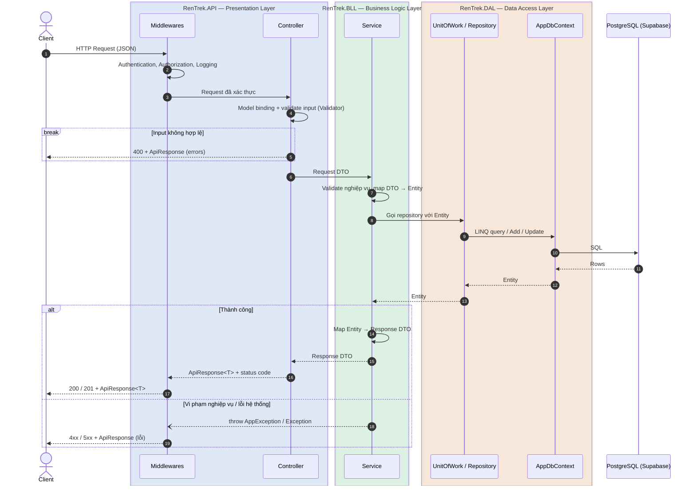
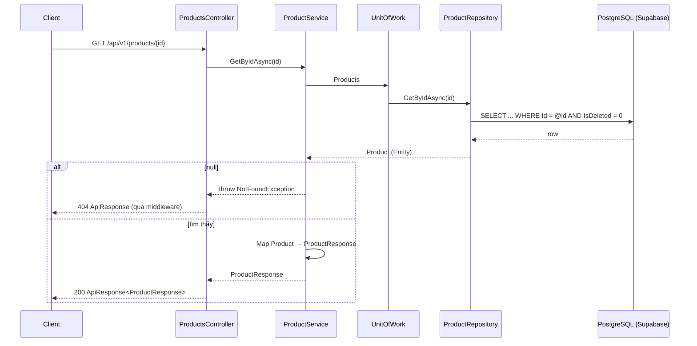

# 02 — Kiến trúc hệ thống (3-Layer Architecture)

> Backend **renTrek** được tổ chức theo mô hình **3 layers**:
> **Presentation (API)** → **Business Logic (BLL)** → **Data Access (DAL)**.
>
> Tech stack: ASP.NET Core Web API (.NET 8), Entity Framework Core, PostgreSQL trên Supabase, JWT Authentication, Swagger.

## Mục lục

1. [Tổng quan](#1-tổng-quan)
2. [Cấu trúc Solution](#2-cấu-trúc-solution)
3. [Chi tiết từng layer](#3-chi-tiết-từng-layer)
4. [Dependency Injection](#4-dependency-injection)
5. [Ví dụ end-to-end](#5-ví-dụ-end-to-end-get-product-theo-id)
6. [Quy tắc bắt buộc](#6-quy-tắc-bắt-buộc)
7. [Cách thêm một module mới](#7-cách-thêm-một-module-mới)

---

## 1. Tổng quan



**Dữ liệu đi qua ranh giới các layer:**

| Ranh giới | Kiểu dữ liệu |
|---|---|
| Client ↔ API | JSON (`ApiResponse<T>`) |
| API ↔ BLL | Request DTO / Response DTO |
| BLL ↔ DAL | Entity |
| DAL ↔ Database | SQL (qua EF Core) |

**Chiều phụ thuộc (project reference):**

```
RenTrek.API  ──►  RenTrek.BLL  ──►  RenTrek.DAL
     └───────────────────────────────►  (chỉ để đăng ký DI, xem mục 4)
```

- Layer trên **chỉ biết** layer ngay dưới nó.
- Layer dưới **không bao giờ** reference layer trên (DAL không biết BLL, BLL không biết API).
- Giao tiếp giữa các layer qua **interface**, không qua class cụ thể.

---

## 2. Cấu trúc Solution

```
BE/
├── RenTrek.sln
├── docs/
│   ├── 01-CONVENTIONS.md
│   ├── 02-ARCHITECTURE.md
│   └── 03-API-CONTRACT.md
├── src/
│   ├── RenTrek.API/                         # ── Presentation Layer
│   │   ├── Controllers/
│   │   │   ├── AuthController.cs
│   │   │   └── ProductsController.cs
│   │   ├── Middlewares/
│   │   │   └── ExceptionHandlingMiddleware.cs
│   │   ├── Common/
│   │   │   └── ApiResponse.cs
│   │   ├── Extensions/
│   │   │   ├── SwaggerExtensions.cs
│   │   │   └── AuthenticationExtensions.cs
│   │   ├── Properties/launchSettings.json
│   │   ├── appsettings.json
│   │   ├── appsettings.Development.json      # KHÔNG commit secret
│   │   └── Program.cs
│   │
│   ├── RenTrek.BLL/                          # ── Business Logic Layer
│   │   ├── Services/
│   │   │   ├── Interfaces/
│   │   │   │   └── IProductService.cs
│   │   │   └── Implementations/
│   │   │       └── ProductService.cs
│   │   ├── DTOs/
│   │   │   ├── Common/
│   │   │   │   ├── PagingRequest.cs
│   │   │   │   └── PagedResult.cs
│   │   │   └── Product/
│   │   │       ├── CreateProductRequest.cs
│   │   │       ├── UpdateProductRequest.cs
│   │   │       ├── ProductQueryRequest.cs
│   │   │       └── ProductResponse.cs
│   │   ├── Validators/
│   │   │   └── Product/CreateProductRequestValidator.cs
│   │   ├── Mappings/
│   │   │   └── ProductProfile.cs
│   │   ├── Exceptions/
│   │   │   ├── AppException.cs               # base
│   │   │   ├── BadRequestException.cs
│   │   │   ├── NotFoundException.cs
│   │   │   ├── ConflictException.cs
│   │   │   ├── UnauthorizedException.cs
│   │   │   └── ForbiddenException.cs
│   │   ├── Helpers/                          # JwtHelper, PasswordHasher, ...
│   │   └── DependencyInjection.cs
│   │
│   └── RenTrek.DAL/                          # ── Data Access Layer
│       ├── Entities/
│       │   ├── BaseEntity.cs
│       │   ├── Product.cs
│       │   └── Enums/
│       ├── Data/
│       │   ├── AppDbContext.cs
│       │   ├── Configurations/
│       │   │   └── ProductConfiguration.cs
│       │   ├── Seeds/
│       │   └── Migrations/
│       ├── Repositories/
│       │   ├── Interfaces/
│       │   │   ├── IGenericRepository.cs
│       │   │   └── IProductRepository.cs
│       │   └── Implementations/
│       │       ├── GenericRepository.cs
│       │       └── ProductRepository.cs
│       ├── UnitOfWork/
│       │   ├── IUnitOfWork.cs
│       │   └── UnitOfWork.cs
│       └── DependencyInjection.cs
│
└── tests/                                    # (tuỳ chọn)
    └── RenTrek.BLL.Tests/
```

---

## 3. Chi tiết từng layer

### 3.1. Presentation Layer — `RenTrek.API`

**Trách nhiệm**

- Nhận HTTP request, model binding, validate format input.
- Gọi Service tương ứng, bọc kết quả vào `ApiResponse<T>`, chọn HTTP status code.
- Cấu hình pipeline: middleware, authentication/authorization, CORS, Swagger.
- Là **composition root**: nơi đăng ký DI cho toàn bộ hệ thống.

**Không được**

- Chứa business logic.
- Inject / dùng `AppDbContext`, Repository, Entity.
- `try/catch` trong controller để trả lỗi — để `ExceptionHandlingMiddleware` xử lý.

```csharp
[ApiController]
[Route("api/v1/products")]
public class ProductsController : ControllerBase
{
    private readonly IProductService _productService;

    public ProductsController(IProductService productService)
    {
        _productService = productService;
    }

    [HttpGet]
    public async Task<IActionResult> GetAll([FromQuery] ProductQueryRequest request)
    {
        var result = await _productService.GetAllAsync(request);
        return Ok(ApiResponse<PagedResult<ProductResponse>>.Ok(result, "Lấy danh sách sản phẩm thành công"));
    }

    [HttpGet("{id:guid}")]
    public async Task<IActionResult> GetById(Guid id)
    {
        var result = await _productService.GetByIdAsync(id);
        return Ok(ApiResponse<ProductResponse>.Ok(result, "Lấy sản phẩm thành công"));
    }

    [HttpPost]
    [Authorize(Roles = "Admin")]
    public async Task<IActionResult> Create([FromBody] CreateProductRequest request)
    {
        var result = await _productService.CreateAsync(request);
        return StatusCode(StatusCodes.Status201Created,
            ApiResponse<ProductResponse>.Ok(result, "Tạo sản phẩm thành công", StatusCodes.Status201Created));
    }
}
```

**Exception middleware**

```csharp
public class ExceptionHandlingMiddleware
{
    private readonly RequestDelegate _next;
    private readonly ILogger<ExceptionHandlingMiddleware> _logger;

    public ExceptionHandlingMiddleware(RequestDelegate next, ILogger<ExceptionHandlingMiddleware> logger)
    {
        _next = next;
        _logger = logger;
    }

    public async Task InvokeAsync(HttpContext context)
    {
        try
        {
            await _next(context);
        }
        catch (Exception ex)
        {
            var (statusCode, message) = ex switch
            {
                AppException appEx => (appEx.StatusCode, appEx.Message),
                _ => (StatusCodes.Status500InternalServerError, "Đã xảy ra lỗi hệ thống")
            };

            if (statusCode >= 500)
                _logger.LogError(ex, "Unhandled exception");

            context.Response.StatusCode = statusCode;
            context.Response.ContentType = "application/json";
            await context.Response.WriteAsJsonAsync(ApiResponse<object>.Fail(message, statusCode));
        }
    }
}
```

### 3.2. Business Logic Layer — `RenTrek.BLL`

**Trách nhiệm**

- Toàn bộ business rule (tính giá thuê, kiểm tra tồn kho, trạng thái đơn, quyền sở hữu...).
- Validate nghiệp vụ; throw custom exception khi vi phạm.
- Mapping Request DTO → Entity và Entity → Response DTO.
- Điều phối nhiều repository trong một transaction qua `IUnitOfWork`.

**Không được**

- Phụ thuộc ASP.NET Core (`IActionResult`, `HttpContext`, `ControllerBase`).
  Cần thông tin user hiện tại → inject `ICurrentUserService` (interface ở BLL, implement ở API).
- Trả Entity ra ngoài.
- Dùng `AppDbContext` trực tiếp (luôn đi qua Repository / UnitOfWork).

```csharp
public interface IProductService
{
    Task<PagedResult<ProductResponse>> GetAllAsync(ProductQueryRequest request);
    Task<ProductResponse> GetByIdAsync(Guid id);
    Task<ProductResponse> CreateAsync(CreateProductRequest request);
    Task<ProductResponse> UpdateAsync(Guid id, UpdateProductRequest request);
    Task DeleteAsync(Guid id);
}

public class ProductService : IProductService
{
    private readonly IUnitOfWork _unitOfWork;
    private readonly IMapper _mapper;

    public ProductService(IUnitOfWork unitOfWork, IMapper mapper)
    {
        _unitOfWork = unitOfWork;
        _mapper = mapper;
    }

    public async Task<ProductResponse> GetByIdAsync(Guid id)
    {
        var product = await _unitOfWork.Products.GetByIdAsync(id)
            ?? throw new NotFoundException($"Không tìm thấy sản phẩm với id '{id}'");

        return _mapper.Map<ProductResponse>(product);
    }

    public async Task<ProductResponse> CreateAsync(CreateProductRequest request)
    {
        if (await _unitOfWork.Products.ExistsByNameAsync(request.Name))
            throw new ConflictException("Tên sản phẩm đã tồn tại");

        var product = _mapper.Map<Product>(request);
        await _unitOfWork.Products.AddAsync(product);
        await _unitOfWork.SaveChangesAsync();

        return _mapper.Map<ProductResponse>(product);
    }

    // ...
}
```

**Custom exception**

```csharp
public abstract class AppException : Exception
{
    public int StatusCode { get; }
    protected AppException(string message, int statusCode) : base(message) => StatusCode = statusCode;
}

public class NotFoundException : AppException
{
    public NotFoundException(string message) : base(message, 404) { }
}
```

### 3.3. Data Access Layer — `RenTrek.DAL`

**Trách nhiệm**

- Định nghĩa Entity, `AppDbContext`, cấu hình Fluent API, migration, seed data.
- Cung cấp Repository để truy vấn / ghi dữ liệu.
- `UnitOfWork` gom các repository và `SaveChangesAsync` trong một transaction.

**Không được**

- Chứa business rule.
- Biết về DTO.
- Gọi `SaveChanges` bên trong Repository (để UnitOfWork quyết định).

```csharp
public abstract class BaseEntity
{
    public Guid Id { get; set; } = Guid.NewGuid();
    public DateTime CreatedAt { get; set; } = DateTime.UtcNow;
    public DateTime? UpdatedAt { get; set; }
    public bool IsDeleted { get; set; }
}

public class Product : BaseEntity
{
    public string Name { get; set; } = string.Empty;
    public string? Description { get; set; }
    public decimal PricePerDay { get; set; }
    public int Quantity { get; set; }
    public Guid CategoryId { get; set; }
    public Category Category { get; set; } = null!;
}
```

**Generic Repository**

```csharp
public interface IGenericRepository<TEntity> where TEntity : BaseEntity
{
    Task<TEntity?> GetByIdAsync(Guid id);
    IQueryable<TEntity> Query();                 // để Service build filter/paging
    Task AddAsync(TEntity entity);
    void Update(TEntity entity);
    void Remove(TEntity entity);                 // soft delete
}

public class GenericRepository<TEntity> : IGenericRepository<TEntity> where TEntity : BaseEntity
{
    protected readonly AppDbContext _context;
    protected readonly DbSet<TEntity> _dbSet;

    public GenericRepository(AppDbContext context)
    {
        _context = context;
        _dbSet = context.Set<TEntity>();
    }

    public async Task<TEntity?> GetByIdAsync(Guid id) => await _dbSet.FirstOrDefaultAsync(e => e.Id == id);
    public IQueryable<TEntity> Query() => _dbSet.AsNoTracking();
    public async Task AddAsync(TEntity entity) => await _dbSet.AddAsync(entity);
    public void Update(TEntity entity) { entity.UpdatedAt = DateTime.UtcNow; _dbSet.Update(entity); }
    public void Remove(TEntity entity) { entity.IsDeleted = true; Update(entity); }
}
```

**Repository riêng** — chỉ tạo khi cần query đặc thù:

```csharp
public interface IProductRepository : IGenericRepository<Product>
{
    Task<bool> ExistsByNameAsync(string name);
}
```

**Unit of Work**

```csharp
public interface IUnitOfWork : IDisposable
{
    IProductRepository Products { get; }
    // IBookingRepository Bookings { get; }
    // IUserRepository Users { get; }

    Task<int> SaveChangesAsync(CancellationToken cancellationToken = default);
    Task BeginTransactionAsync();
    Task CommitAsync();
    Task RollbackAsync();
}
```

**Soft delete** — áp dụng global query filter trong `AppDbContext`:

```csharp
modelBuilder.Entity<Product>().HasQueryFilter(p => !p.IsDeleted);
```

---

## 4. Dependency Injection

Mỗi layer tự đăng ký service của mình qua extension method; `Program.cs` chỉ gọi các extension.

```csharp
// RenTrek.DAL/DependencyInjection.cs
public static class DependencyInjection
{
    public static IServiceCollection AddDataAccessLayer(this IServiceCollection services, IConfiguration configuration)
    {
        services.AddDbContext<AppDbContext>(options =>
            options.UseNpgsql(configuration.GetConnectionString("DefaultConnection")));

        services.AddScoped(typeof(IGenericRepository<>), typeof(GenericRepository<>));
        services.AddScoped<IProductRepository, ProductRepository>();
        services.AddScoped<IUnitOfWork, UnitOfWork>();
        return services;
    }
}

// RenTrek.BLL/DependencyInjection.cs
public static class DependencyInjection
{
    public static IServiceCollection AddBusinessLayer(this IServiceCollection services)
    {
        services.AddAutoMapper(typeof(DependencyInjection).Assembly);
        services.AddValidatorsFromAssembly(typeof(DependencyInjection).Assembly);
        services.AddScoped<IProductService, ProductService>();
        return services;
    }
}

// RenTrek.API/Program.cs
builder.Services.AddDataAccessLayer(builder.Configuration);
builder.Services.AddBusinessLayer();
```

> `RenTrek.API` reference `RenTrek.DAL` **chỉ** để gọi `AddDataAccessLayer`. Controller tuyệt đối không dùng type nào của DAL.

**Lifetime:**

| Loại | Lifetime |
|---|---|
| `AppDbContext`, Repository, UnitOfWork, Service | `Scoped` |
| Helper không trạng thái (JwtHelper, PasswordHasher) | `Singleton` hoặc `Scoped` |
| `IMapper` | do AutoMapper quản lý |

---

## 5. Ví dụ end-to-end: GET product theo id



---

## 6. Quy tắc bắt buộc

| # | Quy tắc |
|---|---|
| 1 | API → BLL → DAL. **Không** gọi ngược, **không** nhảy cóc (Controller → Repository). |
| 2 | Giao tiếp giữa layer qua **interface**, inject qua constructor. |
| 3 | Entity **chỉ** tồn tại trong DAL và BLL. Ra khỏi BLL phải là DTO. |
| 4 | DTO nằm ở BLL. DAL không biết DTO. |
| 5 | Business logic **chỉ** nằm ở Service. |
| 6 | Mọi I/O (DB, HTTP, file) dùng `async/await`, method có hậu tố `Async`. |
| 7 | `SaveChangesAsync` chỉ gọi qua `IUnitOfWork` trong Service. |
| 8 | Lỗi được báo bằng exception, middleware chịu trách nhiệm format response. |
| 9 | Config / secret đọc từ `appsettings` / User Secrets / biến môi trường — không hard-code. |
| 10 | Query chỉ đọc dùng `AsNoTracking()`; tránh N+1 (dùng `Include` / projection `Select`). |

---

## 7. Cách thêm một module mới

Ví dụ thêm module **Booking**:

1. **DAL**
   - [ ] Tạo `Entities/Booking.cs` kế thừa `BaseEntity`.
   - [ ] Thêm `DbSet<Booking>` vào `AppDbContext` + `Data/Configurations/BookingConfiguration.cs`.
   - [ ] (Nếu cần query riêng) `IBookingRepository` / `BookingRepository`.
   - [ ] Thêm `Bookings` vào `IUnitOfWork` / `UnitOfWork`, đăng ký DI.
   - [ ] `dotnet ef migrations add AddBookingTable -p src/RenTrek.DAL -s src/RenTrek.API`
2. **BLL**
   - [ ] Tạo DTO trong `DTOs/Booking/`: `CreateBookingRequest`, `BookingResponse`, ...
   - [ ] Validator trong `Validators/Booking/`.
   - [ ] Mapping profile `Mappings/BookingProfile.cs`.
   - [ ] `IBookingService` / `BookingService`, đăng ký trong `AddBusinessLayer`.
3. **API**
   - [ ] Tạo `Controllers/BookingsController.cs`.
   - [ ] Test qua Swagger.
4. **Docs**
   - [ ] Cập nhật [`03-API-CONTRACT.md`](03-API-CONTRACT.md).
